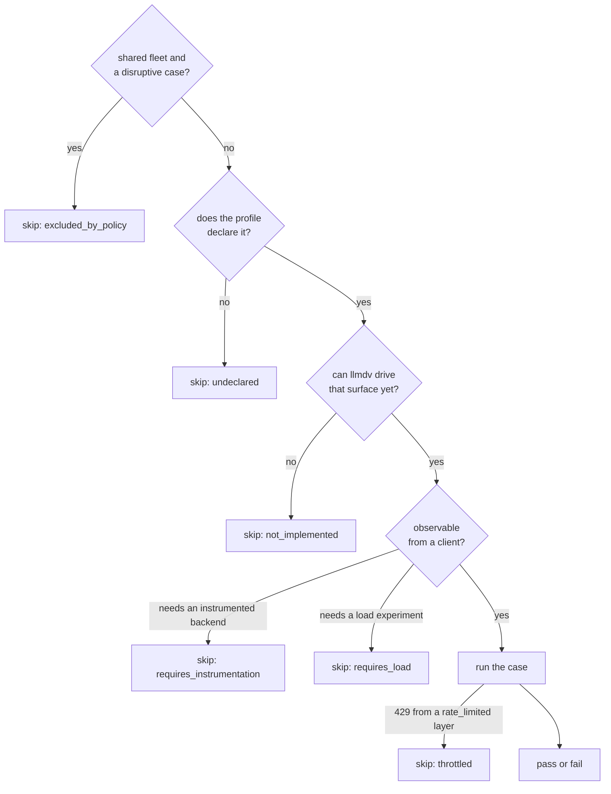

# llm-d-validate manual

Functional validation for deployed [llm-d](https://github.com/llm-d/llm-d) model serving stacks.
The command is `llmdv`.

`llmdv` proves that clients can complete the API exchanges they depend on, through every ingress
a fleet exposes, against infrastructure that is already deployed.

It never deploys, patches, scales or restarts anything. Cluster access, when given, is read-only
and structurally enforced: every `kubectl` or `oc` call goes through a verb allowlist of `get`,
`version`, `config` and `logs`.

## Install

```sh
./install.sh          # llmdv only
./install.sh --s3     # adds boto3, for --remote-output s3://...
./install.sh --dev    # the dev, s3 and ibm-cos extras: ruff, pre-commit, pytest-xdist, both publishing backends
```

It checks the Python floor, creates `.venv`, installs `llmdv` editable, and checks the entry point
and the pytest plugin. Re-run it to pick up a dependency change; `--recreate` starts over.

By hand, the equivalent of `--dev` is:

```sh
python3 -m venv .venv && ./.venv/bin/pip install -e '.[dev,s3,ibm-cos]'
```

## Quick start against a live fleet

With only a gateway URL and a key, start from
[`example-gateway-only.yaml`](profiles/examples/example-gateway-only.yaml). With cluster access,
the two-ingress example drives the engine and the router through port-forwards:

```sh
llmdv profile show profiles/examples/example-two-ingress.yaml --matrix   # what the profile claims, and what will run
llmdv profile show profiles/examples/example-two-ingress.yaml --setup    # the port-forwards; run them in another shell
llmdv verify --profile profiles/examples/example-two-ingress.yaml
```

A run opens with a banner and ends with a summary:

```
  llmdv 0.1.0  verify · example-two-ingress · 2 ingresses

── preflight · 2 ingresses ──────────────────────────────────────
   ok    vllm     http://localhost:18100                               81ms
   ok    router   http://localhost:18180                               87ms

── contract · 12 cases ──────────────────────────────────────────
   ok    vllm     declared_surfaces_exist                              0.54s
   skip  router   header_disposition [x-request-id]   requires_instrumentation

  PASSED · 21 of 22 cases passed, 1 skipped · 13.4s
```

Cases run grouped by phase, contract first, then by ingress in the order the profile declares
them. `-v` prints the recorded checks under each case. How llmdv finds a cluster CLI, and which
stream gets what, is in [ARCHITECTURE.md](ARCHITECTURE.md#how-a-request-reaches-the-fleet).

## Selecting what runs

```sh
llmdv verify --profile P --client forge        # the cases a client depends on
llmdv verify --profile P --surface responses   # one API surface
llmdv verify --profile P --ingress litellm     # one layer
llmdv verify --profile P -m contract           # check the profile against reality
llmdv verify --profile P -m "not disruptive"   # leave the fleet alone
llmdv verify --profile P -k discovery          # a pytest keyword expression
llmdv verify --profile P -- -x --tb=long       # anything after -- goes to pytest
```

Repeating a selector is a union; different selectors intersect. `-k` and `-m` can narrow a
selection but never widen it. The ingress id is the parametrisation id, so `-k router` keeps one
column.

`-m` accepts one marker per suite package under `src/llmdv/suites/`: `anthropic_messages`,
`cache`, `contract`, `discovery`, `evolution`, `field_options`, `fleet`, `long_context`,
`openai_chat`, `openai_completions`, `openai_responses`, `real_clients`, `render`, `scenarios`,
`streaming`, `tools`, `transport` and `unhappy`. Cases also carry `disruptive`, `surface`,
`surface_generic`, `case_id` and `needs`. A name that is not a marker exits `2` and lists the
ones that exist, rather than deselecting everything and reporting `PASSED`.

### Driving a real Claude Code client

```sh
llmdv verify --profile P --client claude-code -k test_claude_code_smoke   # one generation, tools disabled
llmdv verify --profile P -k test_sessions                                 # the tool-using sessions
```

These run the actual client binary through a local recording relay. The profile must declare a
pinned binary under [`clients`](profiles/REFERENCE.md#clients) and an ingress must declare
`messages`; sessions also need `capabilities.client_sessions`. The runner image built from
[`Containerfile`](Containerfile) ships a pinned binary.

> **The sessions execute model-generated code.** Writes are confined to a project directory, but
> reads and executed code are not. Run them in a disposable pod or container, never on a
> workstation you care about.

## Exit codes

Separating environment problems from fleet problems is the point of having more than two.

| Code | Meaning |
| --- | --- |
| `0` | every selected case passed (skips do not fail a run) |
| `1` | test failures: **the fleet** |
| `2` | bad usage, or an invalid profile |
| `3` | preflight unsatisfied: **your vantage point**; nothing was tested |
| `4` | an internal error in llmdv |
| `5` | verification passed, but results were not published (or, from `llmdv notify`, the notification was not sent) |
| `6` | stopped by SIGINT or SIGTERM, e.g. a run budget or a pod being stopped; what finished is kept and published |

A delivery failure never hides a verification failure: failed tests and a failed upload exit
`1`, and `outcome.json` records both. `5` is returned only when verification succeeded.

## Skip classes

A matrix that renders "the fleet does not support this" and "llmdv cannot test it yet" as the same
grey box reads as coverage. Every skip carries one of six classes:

| Class | Meaning |
| --- | --- |
| `undeclared` | the fleet does not expose this; nothing is wrong |
| `not_implemented` | llmdv cannot drive it yet; a gap in the tool |
| `requires_instrumentation` | needs an instrumented backend to observe |
| `requires_load` | needs a load experiment, i.e. a system test |
| `excluded_by_policy` | the profile declares the fleet shared, and this case is disruptive |
| `throttled` | a layer declared `rate_limited` refused the request for being over quota |

They are decided in this order, so the first honest answer wins:



Only the last branch produces a verdict. The other six are reported as what they are, not
counted as coverage.

## Profiles

A profile is hand-written YAML describing one fleet from one vantage point. It carries no
secrets or hostnames: `auth.key_env` and `base_url_env` name environment variables. Start with
[profiles/README.md](profiles/README.md); every field is in
[profiles/REFERENCE.md](profiles/REFERENCE.md).

## Output

Every case, passing or failing, records the observations its assertions made and the HTTP
traffic behind them.

```
runs/<utc-timestamp>/            # echoed in the banner and the summary
  env.json                       # versions, run id, labels, the resolved setup
  outcome.json                   # how the run ended: class, counts, failures, publication, the
                                 # builds seen behind each ingress (system_fingerprint, versions)
  alerts.json                    # llmdv job only: verdicts joined with the comparison
  results.jsonl                  # schema llmdv.results/1: one record per case, with its checks
  exchanges.jsonl                # every request/response with ingress, kind and case metadata
  summary.md                     # the per-ingress table and the attribution reading
  llmdv.log                      # always full DEBUG, redacted
  profile.used.yaml              # the profile as the run read it
  reproduce.sh                   # reruns the whole verification
  logs/                          # pod logs with --pod-logs; index references whole offloads
  failures/<ingress>/<case>/     # always written for a failure
  cases/<ingress>/<case>/        # every case, with --evidence all
    verdict.txt                  # what was claimed and the observations behind it
    checks.json                  # the same, structured
    request.json  response.json  # redacted
    transcript.sse               # streamed cases; capped locally, with whole-copy reference
    repro.sh                     # runnable curl; reads the credential from the environment
  MANIFEST.json                  # with --remote-output: every file's sha256, published last
```

The run directory is created before the profile is read, so an invalid profile, a failed
preflight and an interrupted run leave the same bundle, with `outcome.json` saying which.

Each `exchanges.jsonl` line carries `run_id`, `case_id`, `ingress`, `ingress_kind` and `surface`,
so it remains attributable when read without `results.jsonl`. Request correlation headers
`x-llmdv-run-id` and `x-llmdv-case-id` are sent on raw, streaming and SDK requests; a case-specific
header value takes precedence. Response observations such as `server`, `via` and
`x-forwarded-proto` are retained under `served_by.extra` when the ingress exposes them.
They are clues about the responder, not proof of a topology or of which layer generated a
response, and correlation headers do not prove forwarding or backend logging.

`verdict.txt` is the place to start:

```
case     openai_chat.basic_non_streaming
ingress  vllm  (http://localhost:18100)
surface  chat_completions
outcome  PASS

checks
  ok     http_status = 200   expected 200
  ok     finish_reason = 'stop'   expected not an abort
  ok     usage = '15+135=150'   expected present and self-consistent

exchanges  1
  [0] POST http://localhost:18100/v1/chat/completions -> 200  (1.204s)
```

A check is recorded before its assertion fires, so a failure shows the value that caused it. If
a case fails while every recorded check passed, `verdict.txt` says so.

`--pod-logs {off,failures,all}` (default `failures`) also collects each layer's own logs for the
run window, read-only. In a cluster this needs `get` on pods and `get` on `pods/log` in the
profile's namespace.

`--artifact-sink file:///path` or `s3://bucket/prefix` stores transcripts and pod logs that are
too large for the run directory whole. The capped local copy is always kept with a reference;
the sink is checked writable at preflight.

### Reproducing a run

```sh
bash runs/<run>/failures/<ingress>/<case>/repro.sh   # replay one exchange
cd runs/<run> && ./reproduce.sh                       # rerun the verification into a fresh directory
```

`reproduce.sh` reads `profile.used.yaml` beside it, not the repository's copy, and reads
credentials from the environment. Publishing a run with `--remote-output` is covered in
[END-TO-END.md](END-TO-END.md#publish-a-run).

### A dashboard for triage

```sh
llmdv verify --profile P --analyze              # build dashboard.html as the run finishes
llmdv analyze runs/<run>                        # any run, finished, killed or fetched
llmdv analyze runs/<run> --notes notes.json     # embed an analysis written elsewhere
```

`dashboard.html` is one self-contained page: the system under test, failures grouped by their
first failing check, the profile, and every test with its evidence and a replay `curl`. It shows
only what llmdv recorded, and it refuses to write if its data holds a credential. To add an
analysis written elsewhere, pass it with `--notes`.

## Comparing runs

`llmdv compare` reads two runs of the same profile back from the archive and reports which cases
changed their answer. See [COMPARE.md](COMPARE.md).

## Running unattended

`llmdv job` runs verify as a child process, then publishes and notifies however verify ended, so
it suits a CronJob or a CI step. Running from your PC or unattended is in
[END-TO-END.md](END-TO-END.md).

## Extending

A new ingress kind, surface, case or client is additive. See
[ARCHITECTURE.md](ARCHITECTURE.md#extending-llmdv).

## Running llmdv's own tests

No cluster needed: the tests run against a fake fleet on a local socket.

```sh
.venv/bin/python -m pytest tests/ -q             # one test at a time
.venv/bin/python -m pytest tests/ -q -n auto     # in parallel; needs ./install.sh --dev
.venv/bin/ruff check src/ tests/
```

Parallel is for these offline tests only. `llmdv verify` refuses `-n`, `--numprocesses`,
`--maxprocesses`, `--dist` and `--tx` with exit `2`, because live cases depend on order and a
rate-limited key must not be multiplied.

CI runs lint and these tests on Python 3.10 and 3.11 for every pull request
([`offline-tests.yaml`](.github/workflows/offline-tests.yaml)).

## Coverage

What is tested, what is not, and what has run live: [COVERAGE.md](COVERAGE.md).
