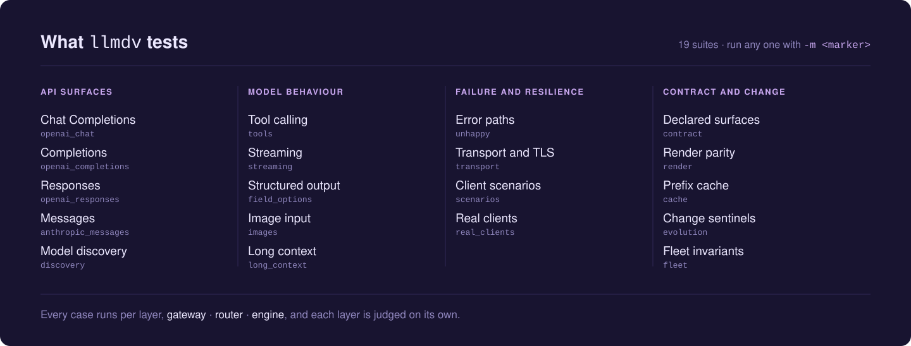

<h1 align="center">llm-d-validate</h1>

<p align="center">
  <b>Roll out <a href="https://github.com/llm-d/llm-d">llm-d</a> with confidence.</b>
  <br><br>
  Demonstrate that your gateway, router, and engine behave as their APIs define.<br>
  Validation for deployed llm-d model serving stacks.
</p>

<p align="center">
  <a href="https://github.com/llm-d-incubation/llm-d-validate/actions/workflows/offline-tests.yaml?query=branch%3Amain"></a>
  
  <a href="https://github.com/llm-d-incubation/llm-d-validate/blob/main/LICENSE"></a>
</p>

<p align="center">
  <a href="https://github.com/llm-d-incubation/llm-d-validate#quick-start-test-a-deployed-llm-d-guide">Quick start</a> ·
  <a href="https://github.com/llm-d-incubation/llm-d-validate/blob/main/docs/README.md">Documentation</a> ·
  <a href="https://github.com/llm-d-incubation/llm-d-validate/blob/main/docs/cli.md">CLI reference</a> ·
  <a href="https://github.com/llm-d-incubation/llm-d-validate/blob/main/docs/test-suites.md">Test suites</a> ·
  <a href="https://github.com/llm-d-incubation/llm-d-validate/blob/main/CONTRIBUTING.md">Contributing</a>
</p>

## How it works

`llmdv` is a functional validation framework for deployed model-serving infrastructure. It
validates gateways, routers and engines against explicit API and deployment expectations,
identifies regressions across runs, and preserves the evidence needed to investigate failures.
Built for llm-d, it also supports other OpenAI- and Anthropic-compatible stacks.

- **Validate behavior across the serving stack.** Test each reachable layer through Chat,
  Completions, Messages and Responses, covering generation, streaming, tool calls, caching,
  headers and error handling.
- **Define the contract for your deployment.** Profiles describe the model, topology, APIs and
  capabilities your stack should support. Select focused checks for a guide or build broader
  coverage for production requirements.
- **Detect regressions, investigate and track failures.** Compare outcomes across layers and
  runs, trace failures to recorded checks and replayable evidence, and link known failures to
  issues so subsequent runs show whether they persist or their fixes have landed.
- **Integrate validation into your operations.** Run checks locally or unattended, explore
  results in a dashboard, publish evidence to S3-compatible storage and deliver Slack
  notifications.
- **Extend coverage within one framework.** Add profiles, test sets, cases, APIs, clients and
  assertions while retaining consistent execution, evidence, comparison and reporting.

> [!NOTE]
> `llmdv` validates existing infrastructure; it never deploys, patches, scales or restarts the
> serving stack. Optional cluster access uses a read-only verb allowlist. Credentials are
> supplied through environment variables and redacted from logs and recorded evidence.

<p align="center">
  
</p>

## Quick start: test a deployed llm-d guide

You need Python 3.10+, Git, a deployed endpoint and a profile matching its configuration.
From a clean machine:

```bash
git clone https://github.com/llm-d-incubation/llm-d-validate.git
cd llm-d-validate
./install.sh
source .venv/bin/activate
```

Choose your profile from the [guide catalog](profiles/llm-d/README.md). For example, if you
have the optimized-baseline Qwen3-32B/vLLM deployment with parsers, set its URL and run smoke:

```bash
export P=profiles/llm-d/optimized-baseline/vllm-qwen3-32b-parsers-standalone.yaml
export LLMDV_ROUTER_URL='https://your-router.example'
llmdv plan --profile "$P" --test-set smoke
llmdv verify --profile "$P" --test-set smoke --analyze
```

Replace the example URL with your reachable router. Smoke checks discovery and basic generation
on the declared APIs; it does not establish full correctness. The command prints the run
folder, containing `summary.md` and `dashboard.html`. Follow [Getting started](docs/getting-started.md)
to interpret the result and run the profile's default coverage.

## Test your own stack

Have another gateway, router or engine? Start with the
[custom-stack walkthrough](docs/getting-started.md#run-your-own-stack). It uses a minimal profile
and your endpoint's model ID, URL and credential. One reachable endpoint is enough; additional
layers are optional.

## What it tests

The [suite catalog](docs/test-suites.md) describes the API, model behavior, error-path and
change-detection checks, and the declarations that enable them. A profile selects applicable
checks; a passing subset says nothing about checks it did not execute. Guide defaults focus on
the guide’s promises. Users can extend profiles, select broader suites and add cases as their
API and production requirements grow. [Plan that progression](docs/getting-started.md#widen-coverage);
`--full-suite` covers the existing library, not every possible API or production requirement.

<p align="center">
  
</p>

## Learn more

- [Documentation by task](docs/README.md): first run, profile selection, results and automation.
- [Choose a profile](profiles/README.md) or [write one](docs/writing-profiles.md).
- [Select tests](docs/cli.md#test-sets-and-coverage) and [compare runs](docs/compare.md).
- [Contribute](CONTRIBUTING.md): add cases, profiles or documentation.
