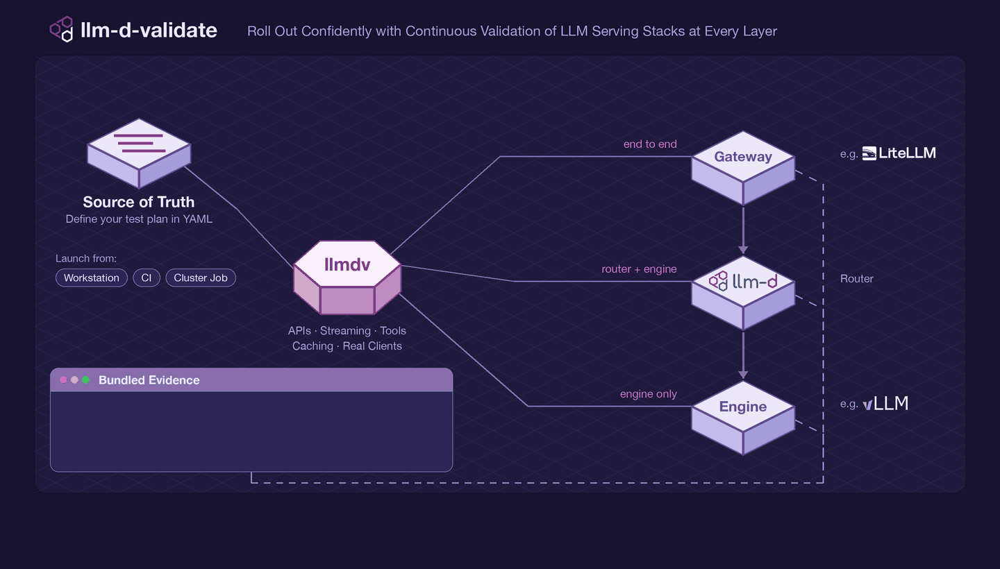

<h1 align="center">llm-d-validate</h1>

<p align="center">
  <b>Functional validation for deployed <a href="https://github.com/llm-d/llm-d">llm-d</a> model serving stacks: the gateway, the router and the engine.</b>
</p>

<p align="center">
  <a href="https://github.com/llm-d-incubation/llm-d-validate/actions/workflows/offline-tests.yaml?query=branch%3Amain"></a>
  
  <a href="https://github.com/llm-d-incubation/llm-d-validate/blob/main/LICENSE"></a>
</p>

<p align="center">
  <a href="#quick-start">Quick start</a> ·
  <a href="https://github.com/llm-d-incubation/llm-d-validate/blob/main/docs/manual.md">Manual</a> ·
  <a href="https://github.com/llm-d-incubation/llm-d-validate/blob/main/profiles/README.md">Profiles</a> ·
  <a href="https://github.com/llm-d-incubation/llm-d-validate/blob/main/docs/architecture.md">Architecture</a> ·
  <a href="https://github.com/llm-d-incubation/llm-d-validate/blob/main/docs/coverage.md">Coverage</a> ·
  <a href="https://github.com/llm-d-incubation/llm-d-validate/blob/main/CONTRIBUTING.md">Contributing</a>
</p>

<p align="center">
  
</p>

- **`llmdv`** sends real requests through each layer of a deployed stack you can reach (gateway,
  router, engine) and checks every answer against what a correct stack must return: Chat,
  Completions, Messages and Responses, streaming, tools, caching, headers and failure paths.
- **A profile** declares the stack: its ingresses, model and capabilities. Every verdict traces
  to a line in that file.
- **Every run is evidence:** results, each request and response, a replay script per failure,
  and an optional dashboard.

> [!NOTE]
> `llmdv` never deploys, patches, scales or restarts anything. Cluster access, where given, is
> read-only and enforced through a verb allowlist. Credentials are named by environment
> variable, never stored, and are redacted from every log and evidence file.

## Quick start

Requires Python 3.10 or newer, a gateway URL and a key for it.

```sh
./install.sh && source .venv/bin/activate

cp profiles/examples/example-gateway-only.yaml profiles/my-stack.local.yaml   # set base_url and model
export LLMDV_GATEWAY_KEY='<gateway key>'

llmdv profile validate profiles/my-stack.local.yaml          # offline check of the profile
llmdv plan --profile profiles/my-stack.local.yaml            # what would run and skip, offline
llmdv verify --profile profiles/my-stack.local.yaml -m contract   # about a minute
llmdv verify --profile profiles/my-stack.local.yaml              # the full run
```

`*.local.yaml` profiles are gitignored, so your hosts never reach the repository. The
[profile guide](https://github.com/llm-d-incubation/llm-d-validate/blob/main/profiles/README.md) covers the two- and three-ingress examples and `extends`, and
[docs/end-to-end.md](https://github.com/llm-d-incubation/llm-d-validate/blob/main/docs/end-to-end.md) covers publishing runs and running unattended.

## What a run gives you

Each run writes a directory under `runs/<timestamp>/`:

| File | What it holds |
| --- | --- |
| `summary.md` | outcomes per ingress, at a glance |
| `results.jsonl` | one record per case, with the checks behind its verdict |
| `exchanges.jsonl` | every request and response, redacted |
| `failures/<ingress>/<case>/` | the failing check, the request and response, and a `repro.sh` that replays it with one exported key |
| `reproduce.sh` | reruns the whole verification |

Add `--analyze` to build `dashboard.html`, one self-contained page with every test, its
evidence and its replay `curl`. `llmdv analyze <run directory>` builds it for any earlier run.

[Output](https://github.com/llm-d-incubation/llm-d-validate/blob/main/docs/manual.md#output) explains every file;
[exit codes](https://github.com/llm-d-incubation/llm-d-validate/blob/main/docs/manual.md#exit-codes) explains how the run ended.

## Repository layout

| Path | What it is |
| --- | --- |
| [`src/llmdv/`](https://github.com/llm-d-incubation/llm-d-validate/tree/main/src/llmdv) | `llmdv`, a pytest-based library and CLI. The [manual](https://github.com/llm-d-incubation/llm-d-validate/blob/main/docs/manual.md) covers every command |
| [`docs/`](https://github.com/llm-d-incubation/llm-d-validate/tree/main/docs) | the [manual](https://github.com/llm-d-incubation/llm-d-validate/blob/main/docs/manual.md), [architecture](https://github.com/llm-d-incubation/llm-d-validate/blob/main/docs/architecture.md), [end-to-end runs](https://github.com/llm-d-incubation/llm-d-validate/blob/main/docs/end-to-end.md), [comparing runs](https://github.com/llm-d-incubation/llm-d-validate/blob/main/docs/compare.md) and [coverage](https://github.com/llm-d-incubation/llm-d-validate/blob/main/docs/coverage.md) |
| [`deploy/`](https://github.com/llm-d-incubation/llm-d-validate/tree/main/deploy) | running `llmdv job` in a cluster: the kustomize base, an example overlay, `trigger.sh` and the infrastructure smoke test |
| [`profiles/`](https://github.com/llm-d-incubation/llm-d-validate/tree/main/profiles) | the [profile guide](https://github.com/llm-d-incubation/llm-d-validate/blob/main/profiles/README.md), the [field reference](https://github.com/llm-d-incubation/llm-d-validate/blob/main/profiles/REFERENCE.md) and templates to copy |
| [`.agents/skills/`](https://github.com/llm-d-incubation/llm-d-validate/tree/main/.agents/skills) | procedures for agents and people, such as [writing a profile](https://github.com/llm-d-incubation/llm-d-validate/blob/main/.agents/skills/writing-an-infra-profile/SKILL.md) and [running and comparing live runs](https://github.com/llm-d-incubation/llm-d-validate/blob/main/.agents/skills/running-and-comparing-live-runs/SKILL.md) |
| [`.github/workflows/`](https://github.com/llm-d-incubation/llm-d-validate/tree/main/.github/workflows) | CI: lint and the offline suite on every pull request |

## Coverage

[docs/coverage.md](https://github.com/llm-d-incubation/llm-d-validate/blob/main/docs/coverage.md) shows what each suite checks, the profile key that enables it, and
what is still missing. `llmdv profile show <profile> --matrix` shows what will run against yours.

## Development

The development install, lint and the offline suite, which needs no cluster or gateway, are in
[CONTRIBUTING.md](https://github.com/llm-d-incubation/llm-d-validate/blob/main/CONTRIBUTING.md#development-and-testing).

A failure traced to an upstream defect can be listed in the profile's `known_failures` with its
issue: it still runs and still fails, but runs and `llmdv compare` show it as known rather than
new, and a regression is never known ([REFERENCE](https://github.com/llm-d-incubation/llm-d-validate/blob/main/profiles/REFERENCE.md#known_failures)).

## Contributing

See [CONTRIBUTING.md](https://github.com/llm-d-incubation/llm-d-validate/blob/main/CONTRIBUTING.md). Questions and ideas are welcome in the
[llm-d Slack](https://llm-d.ai/slack) and in this repository's issues.
