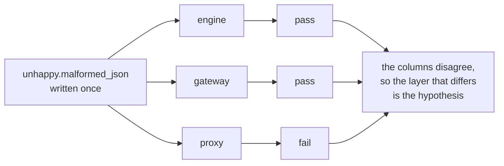
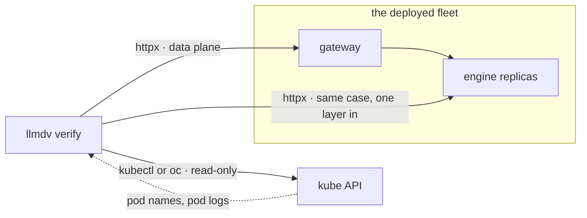
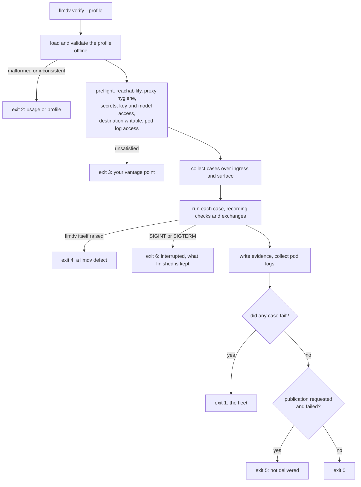

# Architecture

How `llmdv` is laid out, what each part does, and the invariants that keep its results meaningful.
For the profile format see [profiles/README.md](../profiles/README.md); for what is tested, see
[docs/coverage.md](coverage.md).

## The core model

Three axes, kept orthogonal. Everything else follows from this.

| Axis | What varies | Lives in |
| --- | --- | --- |
| **Ingress** | Transport: base URL, auth, timeouts, what the layer reveals about itself | `ingress/` |
| **Surface** | Wire shape: paths, request bodies, response and SSE grammar, error envelope | `surfaces/` |
| **Case** | The property being proven | `suites/` |

A test receives an `Ingress` and a `Surface` and knows the internals of neither, so one case
written once produces one comparable result per *(ingress, surface)* pair:



Attribution is a reading of that table, not a proof, so which endpoint each request was sent to is
recorded on every result and exchange. Response identity headers are observations only: different
layers may emit the same values, and correlation headers do not prove forwarding or backend
logging. The ladder's rows come from the layers a profile declares, ordered by
`kind` (`litellm` fronts `llmd_router` fronts `vllm`). With fewer than two reporting ingresses
there is no ladder: one column is nothing to compare.

## How a request reaches the fleet

Two channels, deliberately separate. The **data plane** is the thing under test: ordinary HTTP to
whatever address the profile declares. The **control plane** only makes the data plane legible:
resolving a selector to a pod that exists now, and pulling logs for the run window.



Every `kubectl` or `oc` call goes through `kube.py`, whose allowlist admits `get`, `version`,
`config` and `logs` and nothing else: there is no code path to `apply`, `delete`, `scale` or
`exec`. A declared metrics source is read the same way: `fleet/prometheus.py` sends
`GET /api/v1/query` only.

`KubeContext` resolves the CLI once: `--kube-cli` (a name or path) if given, otherwise `kubectl`,
then `oc`; `env.json` records the choice as `kube_cli`. Generated setup commands never include a
local kubeconfig path. With no CLI, preflight warns and URL-only testing proceeds; `--pod-logs all`
makes missing log access a preflight failure instead.

From outside the cluster the data plane arrives over a port-forward, which llmdv declares and
checks but never starts, so a dead tunnel fails preflight as your environment rather than as the
fleet. In-cluster, the same profile points at Service DNS and `setup` is empty.

Preflight also sends one authenticated `GET /v1/models` per reachable ingress, since health paths
are exempt from auth. A 401 is a `credentials` problem and a list that omits the profile's
`public_id` is an `access` problem, both exit 3 before any case runs; a 403, a 404 or an
unreadable list is only a warning, because the check could not decide.

## A run, end to end

Each stage fails in its own way, which is what lets the exit code say who is to blame.



The codes are listed in [docs/manual.md](manual.md#exit-codes). Widening `1` to cover an environment
problem is the failure this exists to prevent.

## Directory layout

```
llm-d-validate/
  install.sh              creates .venv and installs llmdv (see docs/manual.md)
  pyproject.toml          console script `llmdv`; pytest11 entry point
  Containerfile           the unattended runner image, pinned by requirements.lock
  deploy/                 trigger.sh, the smoke test and the kustomize base (see deploy/README.md)
  docs/                   the manual, architecture, end-to-end runs, comparing runs, coverage
  profiles/               fleet profiles (see profiles/README.md)
  src/llmdv/
    cli/                  argument parsing, output rendering, exit codes
    profile/              the profile schema and its offline validation
    ingress/              per-layer transport adapters
    surfaces/             per-API wire shapes
    http/                 recording client, SSE reader, redaction, curl generation
    clients/              bounded real-client invocation and the native-request relay
    assertions/           shared assertions, so each lesson is encoded once
    evidence/             what backs a verdict: checks, bundles, reproduction, alerts, dashboard
    compare/              reading archived runs back and diffing them
    collect/              each layer's own logs
    fleet/                configuration, metrics and log invariants; the read-only metrics client
    instruments/          operator-run helpers, such as a header-echo backend
    output/               where a run's artifacts go
    results/              the structured result record
    log/                  the logger tree
    notify.py             a finished run, told to Slack
    preflight.py          is the environment ready, before anything is tested
    kube.py               read-only kubectl/oc adapter
    plugin.py             the pytest plugin that ties it together
    suites/               the functional tests themselves
  tests/                  llmdv's own unit tests; no cluster required
```

The suites ship inside the package so `llmdv verify` finds them when installed into a pod. `tests/`
is not shipped.

## What each module does

### `cli/`
One module per subcommand: `verify_cmd.py` (embeds pytest and owns the run directory, which it
publishes however verification ends), `job_cmd.py`, `publish_cmd.py`, `notify_cmd.py`,
`compare_cmd.py`, `analyze_cmd.py` and `profile_cmd.py` (offline except `show --setup`).
`main.py` holds the shared flags; `banner.py`, `contract_display.py` and `style.py` render output;
`exit_codes.py` holds the codes; `verify_cmd._finish` and `job_cmd._exit_code` apply their precedence.

### `profile/`
`schema.py` holds the dataclasses and two vocabularies: `Disposition` (what a layer does to a
header, and what can verify it) and `SkipClass`. `loader.py` turns YAML into them, reports every
problem with its path, and merges ingress overrides over profile defaults, so every `Ingress`
carries a complete `model` and `capabilities`. `transport.py`, `fleet.py` and `evolution.py` parse
per-ingress HTTP behaviour, fleet invariants and the evolution declarations.

### `ingress/`
`base.py` defines the adapter and `ServedBy`, which endpoint answered, and `version_headers`, the headers whose value names the layer's build (recorded per run in `outcome.json`, see `evidence/stack.py`). `vllm.py`, `router.py` and
`litellm.py` override only what differs, mostly what the layer discloses about its backend. A
registry maps `IngressKind` to adapter.

### `surfaces/`
`base.py` defines `WireSurface` (requests and errors) and `Surface` (generation responses).
`chat_completions.py`, `completions.py`, `responses.py` and `messages.py` implement the surfaces;
`openai.py` holds what the OpenAI ones share; `render.py` the render routes. `SURFACE_PATHS` lists
every declarable surface, deliberately wider than the drivable set. Adapters own their stream
checks, so shared checks never dispatch on surface names.

### `clients/`
`process.py` bounds a subprocess's output and lifetime; `claude_code.py` owns the
version-specific flags. `relay.py` forwards the child's native requests through the recording
client, which owns credentials and blocks hidden retries.

### `http/`
`client.py` is the recording client: raw httpx, because SDKs normalise away what needs proving;
`SdkRecorder` hooks SDK cases into the same evidence. `sse.py` reads streams, keeping partial
transcripts. `redact.py` is the single source of scrubbing; `repro.py` turns an exchange into curl.

### `assertions/`
Shared, so a lesson is encoded once and every surface inherits it. `common.py` holds
finish-reason, output and usage checks; `errors.py` status and envelope checks; surface-specific
modules check native lifecycles before the shared checks. Each records what it observed before
it asserts.

### `evidence/`
`journal.py` records what each case checked; `bundle.py` writes case bundles; `reproduce.py`
writes `reproduce.sh`; `outcome.py` writes `outcome.json`, with the builds each ingress answered from (`stack.py`, read from `exchanges.jsonl` when the run ends); `alerts.py` writes `alerts.json`.
`dashboard.py` renders `dashboard.html` from recorded evidence only, refuses to write a page whose
data holds a credential, and never changes how a run ends.

### `collect/`, `output/`, `results/`, `log/`
Log collection through the read-only adapter. Local and remote sinks (`file://`, and `s3://` in
`output/s3.py`, or `output/ibm_cos.py` under `LLMDV_S3_AUTH=ibm-iam`) also expose object puts for
opt-in oversized-artifact offloading; publication still writes `MANIFEST.json` last. Both S3
paths use redaction-registered credentials, because an S3 error can
echo the access key id into `outcome.json`. `results/` writes versioned `results.jsonl` records.
`log/` provides two streams: diagnostics (per-case progress) to stderr under `--log-level`, and
primary output (banner and summary) to stdout, never suppressed, so `llmdv verify > report.txt`
keeps the report. Colour follows whether each stream is a terminal; `NO_COLOR` and `--no-color`
are honoured.

### `plugin.py`
The pytest plugin: profile loading, the ingress parametrisation, phase ordering, skip
classification, evidence capture and the result records. If you wonder where a fixture comes
from, it is here.

## Invariants

These are load-bearing. Changing one changes what a result means.

**Ingress and surface stay orthogonal.** The moment a case reaches into a layer's internals,
running it elsewhere stops being a comparison.

**A skip carries its class.** One of the [six skip classes](manual.md#skip-classes):
`undeclared`, `not_implemented`, `requires_instrumentation`, `requires_load`,
`excluded_by_policy`, `throttled`. Collapsing them makes a matrix read as coverage when it is not.

**Exit codes separate the fleet from the operator.** `1` is the fleet, `3` is your vantage point,
`5` is delivery, `6` is an interruption. A delivery failure never masks a test failure.

**No `print`.** Ruff rule `T20` enforces it. Output goes through the logger tree so one flag
governs everything the process emits.

**Redaction happens at capture, at the logging layer, and at every run-file writer.** The
logging filter covers httpx, which logs request headers at DEBUG. The writers redact again,
because a fleet can echo a credential inside a body, and the run directory is what
`--remote-output` publishes. `repro.sh` keeps its own `Bearer ${KEY}` so it stays replayable.

**A verdict carries its evidence.** A pass with no recorded checks is indistinguishable from a
test that checked nothing.

## Extending llmdv

A new surface, ingress kind, case, client or assertion is additive: register it, preserve the
invariants above, and prove the new case can fail: add the defect to `tests/fakes.py` and assert
the failure, including that a recorded check is marked not-ok. The steps are in the
[`extending-llmdv`](../.agents/skills/extending-llmdv/SKILL.md) skill.

## Testing your change

```sh
.venv/bin/python -m pytest tests/ -q     # no cluster needed
.venv/bin/ruff check src/ tests/
```

`tests/fakes.py` is a real HTTP server on a local socket, not a mock, with flags for the
misbehaviours the suite exists to catch. If you add a case, add its defect to the fake and prove
the case catches it.
