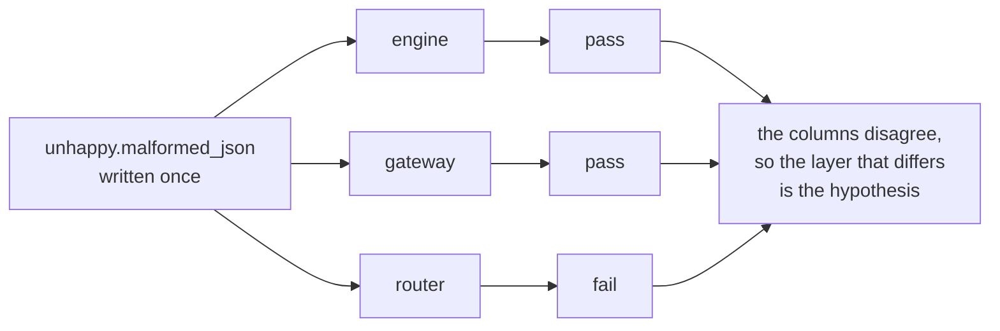
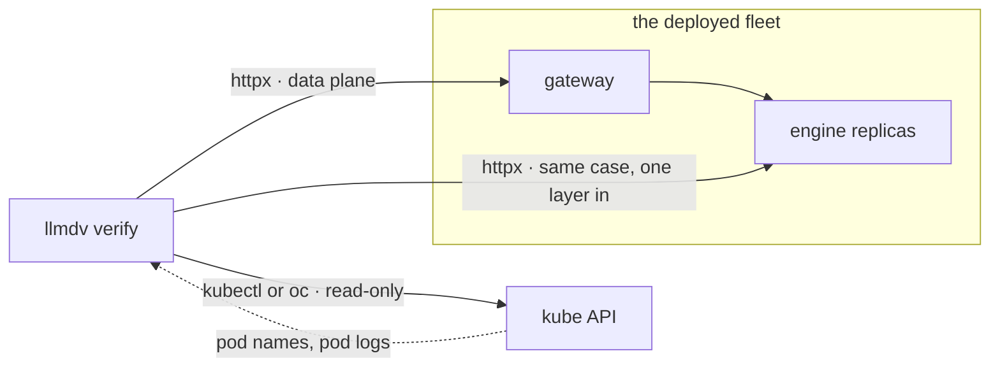
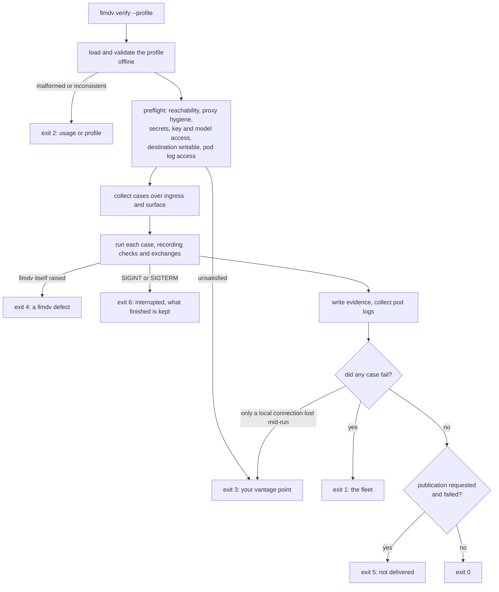

# Architecture

How `llmdv` is laid out, what each part does, and the invariants that keep its results meaningful.
For the profile format see [profiles/README.md](../profiles/README.md); for what is tested, see
[test-suites.md](test-suites.md).

## The core model

Three axes, kept orthogonal.

| Axis | What varies | Lives in |
| --- | --- | --- |
| **Ingress** | Transport: base URL, auth, timeouts, what the layer reveals about itself | `ingress/` |
| **Surface** | Wire shape: paths, request bodies, response and SSE grammar, error envelope | `surfaces/` |
| **Case** | The property being proven | `suites/` |

A test receives an `Ingress` and a `Surface` and knows the internals of neither, so one case
written once produces one comparable result per *(ingress, surface)* pair:



Attribution is a reading of that table, not a proof, so every result and exchange records which
endpoint it was sent to. Response identity headers are observations only: layers may emit the
same values, and a correlation header proves neither forwarding nor backend logging.

The layers form a graph (`profile/topology.py`, `Profile.topology`), built one of two ways:

- **Derived** (`Topology.derive`), when no ingress declares `fronts`: from `kind`, a position
  (`gateway` fronts `router` fronts `engine`), never a product. Two ingresses of one kind, such
  as a prefill and a decode engine, are peers.
- **Declared** (`Topology.declare`), when any ingress declares `fronts`: the declared edges are
  the whole graph. That is how a profile puts two layers of one kind in series, such as a router
  in front of a per-pod routing sidecar that fronts a prefill and a decode engine.

`loader.load` builds a declared graph, so an unknown id, an id listed twice in one `fronts`, a
self-edge, an edge to an ingress at a shallower position, a cycle or an ingress on no edge is an
invalid profile (exit 2), never a mid-run
error.

A layer is compared only with the nearest layers behind it that reported: from each layer, step
to the ones it fronts, compare with any that reported, and only if none did, step on through
them. A gateway in front of two routers, one of which reported, is compared with that router,
and that router with the engine; ingresses with no edge between them are peers, never compared. The alert feed reads the graph the run records in `outcome.json` by the same rule; a
recorded graph that misses a layer that reported is read as no graph. Fewer than two reporting
ingresses make no ladder.

## How a request reaches the fleet

Two channels, kept separate. The **data plane** is the thing under test: ordinary HTTP to the
address the profile declares. The **control plane** only makes the data plane legible: resolving
a selector to a pod that exists now, and pulling logs for the run window.



Every `kubectl` or `oc` call goes through `kube.py`, whose allowlist admits `get`, `version`,
`config` (`current-context` only) and `logs`: there is no code path to `apply`, `delete`,
`scale` or `exec`. A declared metrics source is read the same way: `fleet/prometheus.py` sends
`GET /api/v1/query` only.

`KubeContext` resolves the CLI once (`--kube-cli`, else `kubectl`, then `oc`) and `env.json`
records it as `kube_cli`. With no CLI, URL-only testing proceeds unless `--pod-logs all` asks for
logs.

Each layer is reached at the URL its profile names. A profile whose layers need local setup
declares it in `setup`, which llmdv checks but never starts, so a dead tunnel fails preflight as
your environment, not the fleet.

Preflight checks the operator's side before any case runs: reachability, credentials and model
access (one authenticated `GET /v1/models` per ingress), and that each declared API answers a
shape-valid probe. A mismatch names the profile field and the observed value and exits 3; see
[cli.md](cli.md).

## Run identity

Each run records one identity (`identity.py`) in `outcome.json`, `alerts.json` and
`comparison.json`:

| From | Dimensions |
| --- | --- |
| the profile | `guide`, `model`, `engine`, `gateway` (top-level fields naming the products) |
| `--identity` | `accelerator`, `provider`, `llm_d_ref`, `trigger` (default `manual`), `flavor` |
| llmdv | `llmdv_version`, `profile_digest` |

`--identity` also accepts `guide`, `engine`, `gateway` and `model` as assertions: a value that
disagrees with the profile is an error. Automatic comparisons require matching configuration
dimensions (all but `llm_d_ref`, `llmdv_version` and `profile_digest`), so different overlays
never become one another's baselines. An unreadable archived identity is an archive or
environment error, not a legacy run. See [compare.md](compare.md).

## A run, end to end

Each stage fails in its own way, which is what lets the exit code say who is to blame.



The codes are listed in [cli.md](cli.md#exit-codes).

## Directory layout

```
llm-d-validate/
  install.sh        creates .venv and installs llmdv (see docs/getting-started.md)
  pyproject.toml    console script `llmdv`; pytest11 entry point
  Containerfile     the unattended runner image, pinned by requirements.lock
  deploy/           trigger.sh, the smoke test and the kustomize base (see deploy/README.md)
  docs/             getting started, the CLI, architecture, comparing runs, test suites
  profiles/         llm-d guide profiles, examples and parts (see profiles/README.md)
  src/llmdv/        the package: library, CLI and suites (see the module map below)
  tests/            llmdv's own unit tests; no cluster required
```

The suites ship inside the package so `llmdv verify` finds them when installed into a pod.
`tests/` is not shipped.

## Module map

The one place modules are described. Paths are under `src/llmdv/`.

| Module | Responsible for |
| --- | --- |
| `cli/` | One `*_cmd.py` per subcommand; `verify_cmd.py` embeds pytest and owns the run directory, publishing it however verification ends. `exit_codes.py` holds the codes. |
| `profile/` | The profile schema (`schema.py`: dataclasses, `Disposition`, `SkipClass`), loading with every problem reported by path (`loader.py`), `extends` (`compose.py`), the layer graph (`topology.py`). Fields: [REFERENCE.md](../profiles/REFERENCE.md). |
| `ingress/` | What a response reveals, not per-product adapters: `signals.py` is the one table of headers and body markers (`version`, `backend`, `recorded`, `signature`), read at every ingress; `base.py` builds `ServedBy` and the ingress's recording client. A new product needs no code. |
| `surfaces/` | Per-API wire shapes: Chat, Completions, Responses, Messages and render, plus surface-neutral builders so a case never writes a wire field. `SURFACE_PATHS` lists every declarable surface. |
| `http/` | The recording client (raw httpx; `SdkRecorder` for SDK cases), the SSE reader, `redact.py` (the single source of scrubbing) and curl generation. |
| `clients/` | Bounded real-client subprocesses and the relay that sends their native requests through the recording client. |
| `assertions/` | Shared checks, so a lesson is encoded once; `samples.py` is the one statistical check (`count`, `ratio` or `order` over n recorded samples). |
| `evidence/` | Checks (`journal.py`), failure bundles, `reproduce.sh`, `outcome.json` with the builds seen per ingress (`stack.py`), `alerts.json`, and `dashboard.html`, which refuses to write a page holding a credential. |
| `compare/` | Reading archived runs and diffing them over a window ([compare.md](compare.md)). |
| `collect/` | Each layer's logs for the run window, through `kube.py`. |
| `fleet/` | Configuration, metrics and log invariants; `prometheus.py` is the read-only metrics client. |
| `instruments/` | Operator-run helpers llmdv never deploys, such as `header_echo.py`, a backend that echoes allowlisted headers. |
| `output/` | The run directory and publication to `file://` or `s3://` (`ibm_cos.py` under `LLMDV_S3_AUTH=ibm-iam`); `MANIFEST.json` is written last. |
| `results/` | `results.jsonl`; `read.py` is its one reader and refuses any schema but `llmdv.results/1`, which grows only by optional fields. |
| `log/` | The logger tree: diagnostics to stderr, primary output to stdout, a redaction filter on every record. |
| `suites/` | The functional tests, one package per suite and marker ([test-suites.md](test-suites.md)). |
| `plugin.py` | The pytest plugin: profile loading, ingress parametrisation, skip classes, evidence capture. Every fixture comes from here. |
| `preflight.py`, `kube.py`, `identity.py`, `notify.py` | Environment checks before any case; the read-only kubectl/oc adapter; the run identity; the Slack message. |

## Invariants

These are load-bearing. Changing one changes what a result means.

**Ingress and surface stay orthogonal.** Once a case reaches into a layer's internals, running
it elsewhere stops being a comparison.

**A skip carries its class.** One of the [six skip classes](cli.md#skip-classes): `undeclared`,
`not_implemented`, `requires_instrumentation`, `requires_load`, `excluded_by_policy`,
`throttled`. Collapsing them makes a matrix read as coverage when it is not.

**Exit codes separate the fleet from the operator.** `1` is the fleet, `3` your vantage point,
`5` delivery, `6` an interruption. A delivery failure never masks a test failure, and `1` never
covers an environment problem.

**No `print`.** Ruff rule `T20` enforces it. Output goes through the logger tree so one flag
governs everything the process emits.

**Redaction happens at capture, at the logging layer, and at every run-file writer.** The
logging filter covers httpx, which logs request headers at DEBUG. The writers redact again,
because a fleet can echo a credential inside a body, and `--remote-output` publishes the run
directory. `repro.sh` keeps its own `Bearer ${KEY}` so it stays replayable.

**A verdict carries its evidence.** A pass with no recorded checks is indistinguishable from a
test that checked nothing.

## Extending llmdv

A new surface, case, client or assertion is additive, and a new product at any layer needs no
code. Preserve the invariants above and prove the new case can fail: add the defect to
`tests/fakes.py` and assert the failure, including that a recorded check is marked not-ok. The
steps are in the [`extending-llmdv`](../.agents/skills/extending-llmdv/SKILL.md) skill.

## Testing your change

The commands for the offline suite and lint are in
[CONTRIBUTING.md](../CONTRIBUTING.md#development-and-testing).
