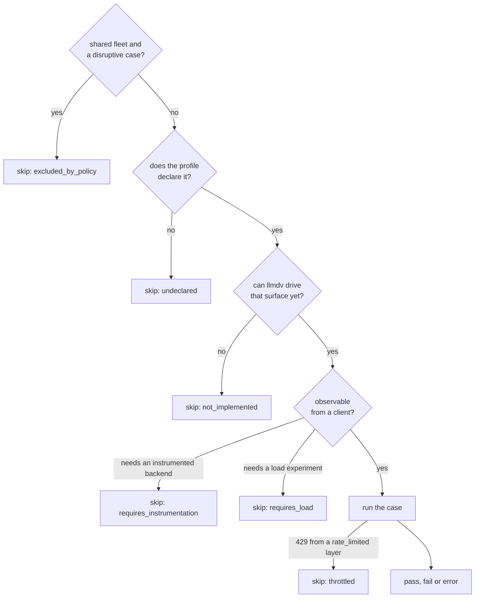

# Command reference

Lookup for every `llmdv` command. For a first run, read [getting-started.md](getting-started.md).

## Commands

| Command | Purpose |
| --- | --- |
| `profile validate <path>` | offline schema and consistency checks |
| `profile show <path>` | the resolved profile; `--test-sets` lists named subsets; `--yaml` exports standalone declarations with environment-variable names preserved; `--matrix` the surfaces it implies, `--setup` each ingress's setup commands, pods resolved live (the only profile command that reads a cluster; the commands never include a local kubeconfig path) |
| `profile explain <path> [--field FIELD]` | offline effective values and source assignments; a field or block such as `ingresses[gateway].model` also includes library defaults; environment values are hidden |
| `plan` | the cases `verify` would run and skip; sends nothing |
| `verify` (`run`, `execute`) | run the cases against a deployed fleet |
| `job` | one unattended run: verify, publish (even after a crash), notify |
| `publish <run_dir>` | upload a run that `verify` did not publish itself |
| `notify <run_dir>` | post a run's outcome to Slack (`$LLMDV_NOTIFY_WEBHOOK`) |
| `compare` | what changed between two runs of the same profile ([compare.md](compare.md)) |
| `analyze <run_dir>` | build `dashboard.html` for a run |

Run `llmdv <command> --help` for its flags. Every command takes the logging flags (`-v` prints
the recorded checks under each case, `-vv` adds DEBUG) and the read-only cluster flags; how `llmdv`
finds a cluster CLI is in [architecture.md](architecture.md#how-a-request-reaches-the-fleet).
The report goes to stdout and diagnostics to stderr, so `llmdv verify > report.txt` keeps the
report; colour follows whether each stream is a terminal, and `NO_COLOR` or `--no-color` turns
it off.

Flags whose behaviour needs more than `--help`:

- **`--local-output ROOT`** chooses the parent directory (default `runs/`). Each invocation
  creates a fresh `<profile>-<utc-timestamp>-<unique-id>/` child. Reusing the root preserves
  earlier runs; it never appends to them. Use the child path printed in the banner for
  `analyze`, `publish`, `notify`, and reproduction scripts. `job --work-dir` uses the same
  local layout. Recorded run IDs and the remote `<profile>/<run-id>/` layout are unchanged,
  so existing comparison history remains usable.
- **`-n` is refused.** `verify` exits `2` on `-n`, `--numprocesses`, `--maxprocesses`, `--dist`
  and `--tx`: live cases depend on order, and a rate-limited key must not be multiplied.
- **`--evidence all`** writes a bundle for every case, not only failures, so a pass can be
  audited.
- **`--analyze`** builds `dashboard.html` before publishing, so it is uploaded with the run.
- **`--skip-preflight`** skips the checks below; a fleet failure may then be a setup problem.
- **`-- ARGS`** go to pytest unparsed: `-- -x --tb=long`.

**Preflight** probes every declared API with the contract suite's shape-valid request, and
compares each declared `model.max_model_len` with the one `GET /v1/models` reports. A mismatch
exits `3` before any case runs, naming the profile field and the observed value. A deployment
that omits its context window is recorded as unchecked, and the run continues. A 403, a 404 or
an unreadable model list only warns; the declared API probes still run.

**`--identity key=value`** (repeatable, `verify` and `job`) declares a lane dimension
(`accelerator`, `provider`, `llm_d_ref`, `trigger`, `flavor`) or a profile assertion (`guide`,
`engine`, `gateway`, `model`). A mismatch or an empty value exits `2`. `trigger` defaults to
`manual`. `flavor` names whatever else tells apart lanes that share a profile, such as
`flavor=lmcache-connector/cpu`; a run that passes none records none. Comparison baselines come
only from runs with matching configuration identity, flavor included. **`--label key=value`** is
free-form, recorded in `env.json` and `outcome.json`; it cannot use an identity key.

## Selecting what runs

### Test sets and coverage

Choose a scope, then narrow it with filters. These rules apply to `plan`, `verify` and `job`.

| Term | Meaning |
| --- | --- |
| Case | One named test, possibly with several ingress/surface variants |
| Suite | Cases on one topic, such as `tools` or `openai_chat` |
| Test set | A profile-defined list of case-ID patterns; `smoke` is built in |
| Full suite | Every verification case in the library, before filters and applicability gates |

| To select | Command |
| --- | --- |
| The profile's default coverage | `llmdv verify --profile P` |
| Basic discovery and generation | `llmdv verify --profile P --test-set smoke` |
| Named sets, combined (if defined by the profile) | `llmdv verify --profile P --test-set default --test-set tools` |
| All profile-defined sets | `llmdv verify --profile P --all-test-sets` |
| Every library case | `llmdv verify --profile P --full-suite` |
| One whole suite | `llmdv verify --profile P --full-suite -m openai_chat` |
| A case within the whole library | `llmdv verify --profile P --full-suite -k <case>` |

A plain invocation requires `test_sets.default`. The three explicit modes (`--test-set`,
`--all-test-sets`, `--full-suite`) replace that default and are mutually exclusive. Repeat
`--test-set` to combine names; overlapping cases run once. `--all-test-sets` includes `default`
and excludes built-ins. Set names must be exact: `--test-set '*'` is invalid.

**Filters only narrow the chosen scope:**

| Filter | Restricts to |
| --- | --- |
| `--ingress router,engine` | Named ingress IDs; repeat flags for a union |
| `--surface messages` | A surface; repeat flags for a union |
| `--client agent` | Cases the declared client depends on; repeat flags for a union |
| `-m tools` | A suite marker or pytest marker expression |
| `-k discovery` | A pytest keyword expression |

Different filters intersect. Without `--ingress`, all declared ingresses are tested. Explicit
empty, whitespace-only or comma-only values and unknown IDs exit 2 before requests; they never
select every layer as a fallback. `-m openai_chat` without `--full-suite` keeps only the matching
cases already in the chosen set. [Test suites](test-suites.md#suites) lists available suite
markers. An unknown marker exits 2.

**Selected does not mean executed.** Surface, capability and policy gates can skip a selected
case. Runtime conditions such as throttling can skip it later. See [skip classes](#skip-classes).
A case excluded by scope or filters is not a skip. An all-skipped run provides no executed
checks. `--identity` and free-form labels never change selection.

Smoke reuses discovery, non-streaming and streaming checks for Chat Completions, Completions,
Responses and Messages. It excludes exhaustive contract checks, tools, reasoning-specific
behavior, cache, long context and fleet checks. Undeclared APIs skip, and preflight still runs.
It is available even when the profile has no sets and cannot be redefined.

Define custom sets with [the profile schema](../profiles/REFERENCE.md#test_sets). Empty set
lists and reserved names are invalid. Unknown requested sets, unmatched patterns in a chosen
set, no sets for `--all-test-sets`, and filters leaving zero cases exit 2 before preflight.
Unchosen patterns are not matched against the inventory. Planning warns when a default omits
contract checks; it does not reject an intentionally small default.

### See what will run

```sh
llmdv plan --profile P --full-suite -m contract            # counts per suite and skip class, then the cases
llmdv plan --profile P --ingress router -q    # counts only
llmdv plan --profile P --json                 # an llmdv.plan/1 document, one row per case
```

`plan` is `verify`'s own collection, stopped before any case runs: each case to run, each skip
with its [class](#skip-classes) and reason, and statistical cases' resolved sample counts. It
sends no request and reads no cluster, so it works before any port-forward is up. It shows the
skips decided up front (`undeclared`, `not_implemented`, `excluded_by_policy`); a planned case
can still skip at run time (`throttled`, `requires_instrumentation`, a declaration the case reads
itself). Selector errors exit `2`. It reports the cases left out by coverage and other filters; `--json` records this under `coverage`. `profile show --matrix` is the
coarser view: surfaces per ingress.

### Driving a real Claude Code client

```sh
llmdv verify --profile P --client claude-code -k test_claude_code_smoke   # one generation, tools disabled
llmdv verify --profile P -k test_sessions                                 # the tool-using sessions
```

These run the client binary through a local recording relay. The profile must declare a pinned
binary under [`clients`](../profiles/REFERENCE.md#clients) and an ingress must declare
`messages`; sessions also need `capabilities.client_sessions`. The runner image ships a pinned
binary ([deploy/README.md](../deploy/README.md)).

> **The sessions execute model-generated code.** Writes are confined to a project directory, but
> reads and executed code are not. Run them in a disposable pod or container.

## Exit codes

Separating environment problems from fleet problems is the point of having more than two.

| Code | Class | Meaning |
| --- | --- | --- |
| `0` | `ok` | no executed case failed; an all-skipped run can also exit 0 |
| `1` | `fleet` | test failures: the fleet did not behave as the profile declares |
| `2` | `usage` | bad usage, or an invalid profile; nothing was verified |
| `3` | `environment` | your environment, not the fleet: preflight unsatisfied (nothing was tested), a local connection lost mid-run with no fleet failure, or a results store that cannot be used as configured |
| `4` | `internal` | an internal error: a defect in llmdv itself |
| `5` | `ok` | verification passed, but results or the notification were not delivered |
| `6` | `interrupted` | stopped by SIGINT or SIGTERM, e.g. a run budget or a pod being stopped; what finished is kept and published |

The class is `verification.class` in `outcome.json`; `publication` says what happened to the
results. A code `llmdv` never returns itself, such as `137` after an OOM kill, is class `crashed`.
A delivery failure never hides a verification failure: failed tests plus a failed upload exit
`1`. Ctrl-C exits `6` in every command.

`publish`, `notify` and `compare` follow the same table:

- `publish` exits `0` once delivered. Otherwise a run that did not pass keeps its code (`1`, or
  `137` passed as `--exit-code 137`) and the publication is recorded `failed`; for a run that
  passed or recorded no code, an unusable store is `3` and a partial upload `5`.
- A run is published to one destination. Publishing there again does nothing; another
  destination is refused with `2`.
- A `results.jsonl` line that is not a result, or an `outcome.json` that is not an outcome, is
  `2`, with the file named. A run that died before recording its verdict is still published and
  notified; unreadable lines are left out of the counts and listed under
  `verification.unreadable_results`.
- `compare` exits `3` when the archive cannot be read ([compare.md](compare.md#exit-codes)).

### A lost local connection

Mid-run, the environment is blamed on one piece of evidence only: the local port refuses
connections. When a request to `localhost`, `127.0.0.1` or `[::1]` fails before any response and
no check of that case had failed, `llmdv` tries a TCP connect to the port three times over one
second. If all are refused, the tunnel is gone: the case is an `error` naming the lost
connection, later cases on that ingress skip as `requires_instrumentation`, and the run exits
`3`. The connect sends no request, so nothing is retried; `llmdv` does not restart the tunnel.
Before each skip the port is tried again; if it accepts, the remaining cases run.

Everything else stays a fleet result, exit `1`, with no case skipped:

- **The port still accepts.** A reset, a cut-off response or a dead health path behind an
  accepting port is a crashing server, or a pod that died behind a live `kubectl port-forward`.
  `llmdv` cannot tell them apart, so it reports the fleet; when every case after some point fails
  the same way, check the forward first.
- **A check failed first.** That failure stands, whatever a later request does.
- **A real failure anywhere in the run**, because the fleet result must not be hidden.
- **An ingress reached any other way**, or a local one that is only slow.

A local server whose process exits also leaves a refusing port, and is reported as a lost
connection. `outcome.json` lists each lost ingress under `connection_lost` with the case that
found it and the counts before and after.

## Skip classes

Every skip carries one of six classes, never collapsed: a matrix that merges "the fleet does not
expose this" with "`llmdv` cannot test it yet" reads as coverage.

| Class | Meaning |
| --- | --- |
| `undeclared` | the fleet does not expose this; nothing is wrong |
| `not_implemented` | `llmdv` cannot drive it yet; a gap in the tool |
| `requires_instrumentation` | needs an instrumented backend to observe, or the ingress's local port (`localhost`, `127.0.0.1`, `[::1]`) stopped accepting connections mid-run and still refuses them |
| `requires_load` | needs a load experiment, i.e. a system test |
| `excluded_by_policy` | the profile declares the fleet shared, and this case is disruptive |
| `throttled` | a layer declared `rate_limited` refused the request for being over quota |

They are decided in this order, so the first honest answer wins. Only the last branch produces a
verdict; a case whose setup fails is recorded as an error.



## Output

Every case, passing or failing, records its observations and the HTTP traffic behind them.

```
runs/<profile>-<utc-timestamp>-<unique-id>/  # echoed in the banner and the summary
  env.json                       # versions, run id, labels, the resolved setup
  outcome.json                   # how the run ended: class, counts, failures, publication, the
                                 # builds seen behind each ingress (system_fingerprint, versions)
  alerts.json                    # llmdv job only: verdicts joined with the comparison
  results.jsonl                  # schema llmdv.results/1: one record per case, with its checks
  exchanges.jsonl                # every request/response with ingress, kind and case metadata
  summary.md                     # the per-ingress table and the attribution reading
  llmdv.log                      # always full DEBUG, redacted
  profile.used.yaml              # the profile as the run read it
  profile.replay.yaml            # test-set runs: freezes the resolved case patterns
  reproduce.sh                   # reruns the recorded verification scope
  dashboard.html                 # with --analyze, or llmdv analyze afterwards
  logs/                          # pod logs with --pod-logs; index references whole offloads
  failures/<ingress>/<case>/     # always written for a failure
  cases/<ingress>/<case>/        # every case, with --evidence all
    verdict.txt                  # what was claimed and the observations behind it
    checks.json                  # the same, structured
    request.json  response.json  # redacted
    transcript.sse               # streamed cases; capped locally, with whole-copy reference
    repro.sh                     # runnable curl; reads the credential from the environment
  MANIFEST.json                  # with --remote-output: every file's sha256, published last
```

The directory and initial outcome are created before verification, so an invalid profile, a
failed preflight and an interrupted run leave the same bundle, with `outcome.json` saying which. Transcripts and
pod logs too large to keep whole go to `--artifact-sink`; the capped local copy keeps a reference.

`results.jsonl` is `llmdv.results/1`, which grows only by optional fields (a check's `observed`
may be any JSON value, a check may carry `rule` and `samples`, a record may carry `claims`), so
older and newer runs compare as one history. `compare`, `analyze`, `publish` and `job` refuse a record under any other
schema, or a JSON line that is not a result, naming the file and line.

Each `exchanges.jsonl` line carries `run_id`, `case_id`, `ingress`, `ingress_kind` and
`surface`. Every request sends `x-llmdv-run-id` and `x-llmdv-case-id` unless the case sets its
own. Response headers such as `server`, `via` and `x-forwarded-proto` land in `served_by.extra`:
clues about the responder, not proof of topology, forwarding or which layer answered.

`verdict.txt` is the place to start:

```
case     openai_chat.basic_non_streaming
ingress  vllm  (http://localhost:18100)
surface  chat_completions
outcome  PASS

checks
  ok     http_status = 200   expected 200
  ok     finish_reason = 'stop'   expected not an abort
  ok     usage = '15+135=150'   expected present and self-consistent

exchanges  1
  [0] POST http://localhost:18100/v1/chat/completions -> 200  (1.204s)
```

A check is recorded before its assertion fires, so a failure shows the value that caused it. A
case that fails with every recorded check passing says so.

### Reproducing a run

```sh
bash runs/<run>/failures/<ingress>/<case>/repro.sh   # replay one exchange
cd runs/<run> && ./reproduce.sh                       # rerun the verification into a fresh directory
```

`reproduce.sh` uses the archived profile beside it. For test-set runs it reads
`profile.replay.yaml`, which freezes the resolved patterns as `test_sets.recorded-run`; for
`--full-suite` runs it reads `profile.used.yaml`. Other filters are retained. Use the recorded
`llmdv` version to reproduce the same library cases. Both scripts read credentials from the environment.

### The dashboard

```sh
llmdv analyze runs/<run>                        # any run, finished, killed or fetched
llmdv analyze runs/<run> --notes notes.json     # embed an analysis written elsewhere
```

`dashboard.html` is one self-contained page: the system under test, failures grouped by their
first failing check, the profile, and every test with its evidence and a replay `curl`. It shows
only what `llmdv` recorded, labels notes as not recorded by `llmdv`, and refuses to write if its data
holds a credential. For an agent-written analysis, use the
[`reporting-a-run`](../.agents/skills/reporting-a-run/SKILL.md) skill.

## Elsewhere

- **Comparing runs:** [compare.md](compare.md).
- **Running unattended:** `llmdv job` in [getting-started.md](getting-started.md#run-unattended);
  the cluster job in [deploy/README.md](../deploy/README.md).
- **Profiles:** [profiles/README.md](../profiles/README.md) and
  [profiles/REFERENCE.md](../profiles/REFERENCE.md).
- **Extending `llmdv`:** a new surface, case or client is additive, and a new gateway, router or
  engine product needs no code
  ([architecture.md](architecture.md#extending-llmdv)).
- **Test suites:** [test-suites.md](test-suites.md): what each suite checks and how to run one.
- **`llmdv`'s own tests:** no cluster needed; see [CONTRIBUTING.md](../CONTRIBUTING.md).
