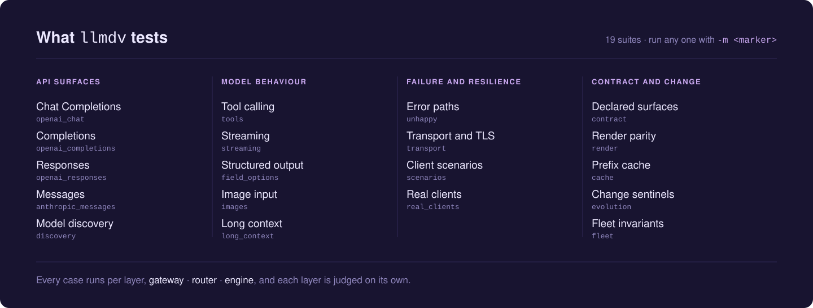

# Test suites

The suites `llmdv` runs, what each one checks, the profile key that turns it on, and what is still
missing. Each suite is a package under `src/llmdv/suites/`, and its name is also its pytest marker.

<p align="center">
  
</p>

## Run a suite

A *suite* is a group of cases on one topic, and its name is the `-m` marker that picks it. It is
not the same as a profile's *test set* (a named list of cases, such as `default` or `smoke`) or the
*full suite* (every case in every suite); [cli.md](cli.md#test-sets-and-coverage) explains all
four.

A run first takes its scope (the profile's `default` set, unless you name another), then `-m`
narrows it. So to run a whole suite, widen the scope with `--full-suite` and then pick the suite:

```sh
llmdv verify --profile <profile> --full-suite -m openai_chat            # the whole openai_chat suite
llmdv verify --profile <profile> --full-suite -m "tools or streaming"   # two suites
llmdv verify --profile <profile> --full-suite -k test_completions_stream_lifecycle   # one case
llmdv verify --profile <profile> -m openai_chat                         # only the default set's openai_chat cases
llmdv plan --profile <profile> --full-suite -m openai_chat              # preview any of these, offline
llmdv profile show <profile> --matrix                                   # what the profile enables, per surface and ingress
```

For example, `-m openai_chat` on a guide profile keeps only its selected Chat cases;
`--full-suite -m openai_chat` selects the whole Chat suite before applicability gates. A case whose `case_id` starts with
another suite's name carries that suite's marker too.
[cli.md](cli.md#selecting-what-runs) has every selector, and
[writing-tests.md](writing-tests.md) explains how to add a case or a suite. For current case counts, use `llmdv plan`; its counts include surface, ingress and option variants.

A profile must declare the features its selected cases need. Use
`llmdv profile show <profile.yaml> --matrix` to inspect applicability.
An offline regression pass says nothing about a live fleet: run the cases against it (see
[getting-started.md](getting-started.md)).

## Suites

All suites below are implemented and exercised by offline failure regressions. Each still needs
the applicable profile declarations to execute against a deployment.

### APIs and model discovery

| Suite | Question it helps answer |
| --- | --- |
| [Discovery](#discovery) (`discovery`) | Is the intended model exposed without silent fallback? |
| [OpenAI Chat](#openai_chat) (`openai_chat`) | Do Chat Completions behave correctly? |
| [OpenAI Completions](#openai_completions) (`openai_completions`) | Do prompt-based Completions behave correctly? |
| [OpenAI Responses](#openai_responses) (`openai_responses`) | Do Responses requests, tools and lifecycle operations work? |
| [Anthropic Messages](#anthropic_messages) (`anthropic_messages`) | Do Messages, thinking and token counting work? |

### Model and client behavior

| Suite | Question it helps answer |
| --- | --- |
| [Tool calling](#tools) (`tools`) | Can clients reliably define, call and return tools? |
| [Field options](#field_options) (`field_options`) | Are requested fields and generation options honored? |
| [Image input](#images) (`images`) | Does the model use the supplied image? |
| [Long context](#long_context) (`long_context`) | Are context limits enforced? |
| [Prefix cache](#cache) (`cache`) | Is prefix reuse visible in native accounting? |
| [Client scenarios](#scenarios) (`scenarios`) | Do multi-request client workflows hold? |
| [Real clients](#real_clients) (`real_clients`) | Does the pinned real client work through the serving chain? |

### Failures and transport

| Suite | Question it helps answer |
| --- | --- |
| [Streaming](#streaming) (`streaming`) | Are streams framed correctly and recoverable? |
| [Unhappy paths](#unhappy) (`unhappy`) | Are invalid requests refused with the intended errors? |
| [Transport](#transport) (`transport`) | Does the HTTP path preserve request and response behavior? |

### Contracts and deployment observations

| Suite | Question it helps answer |
| --- | --- |
| [Repository contract](#contract) (`contract`) | Does the deployment match its declared surfaces and headers? |
| [Render](#render) (`render`) | Are rendered token IDs stable and prefix-preserving? |
| [Change sentinels](#evolution) (`evolution`) | Have response shapes, prompts or rendering changed? |
| [Fleet invariants](#fleet) (`fleet`) | Do declared config, metrics and log rules hold? |

### Suite details

Expand a suite for its full scope and enabling declarations.

<a id="discovery"></a>
<details>
<summary>Discovery</summary>

`/v1/models` lists the model; unknown models get no fallback; retrieval failures retain JSON, text or empty-body evidence.

**Enabled by:** any surface; `model_retrieval`, `model_info`.

</details>

<a id="openai_chat"></a>
<details>
<summary>OpenAI Chat</summary>

Basic, streaming, usage, reasoning, fields, choices, logprobs, answer budget.

**Enabled by:** `chat_completions`; `chat_fields`, `chat_options`, `chat_reasoning_efforts`, `model.reasoning`.

</details>

<a id="openai_completions"></a>
<details>
<summary>OpenAI Completions</summary>

Prompt-based completions, fields, limits, logprobs.

**Enabled by:** `completions`; `completions_fields`.

</details>

<a id="openai_responses"></a>
<details>
<summary>OpenAI Responses</summary>

Basic, streaming, tools, options; stored responses and cancellation, or their clean refusal on a stateless stack.

**Enabled by:** `responses`; `responses_options`, `responses_features`, `stateful_responses`, `background_responses` or `stateless_responses`, `responses_compact`, `responses_input_tokens`.

</details>

<a id="anthropic_messages"></a>
<details>
<summary>Anthropic Messages</summary>

Messages, event order, thinking, streamed thinking and effort, count_tokens, content drops, named request features served or refused (a tool search's `tool_reference` among them).

**Enabled by:** `messages`; `messages_checks`, `messages_thinking`, `messages_efforts`, `count_tokens`, `messages_features`.

</details>

<a id="tools"></a>
<details>
<summary>Tool calling</summary>

Tool calls, streamed arguments, parallel calls, results, loops; every call in sampled coding-agent turns names an offered tool exactly (six by default, `capabilities.samples`); a tool search's `tool_reference` is rendered and a deferred (`defer_loading`) tool it found can be called, where automatic tool choice is declared; no declared call markup in any answer on a tool surface.

**Enabled by:** `model.tools.parser`, `model.tools.auto_choice`, `model.tools.markup`, `messages_features.tool_reference`.

</details>

<a id="streaming"></a>
<details>
<summary>Streaming</summary>

SSE framing, terminal events, `[DONE]` in the model's text, timing, disconnect then recover.

**Enabled by:** streaming surfaces; `transport.stream_budget`.

</details>

<a id="field_options"></a>
<details>
<summary>Field options</summary>

Structured output, JSON mode (with reasoning beside the answer where it is on by default), reasoning usage, observable engine extension options, the effort marker the template renders for each requested effort.

**Enabled by:** `structured_output`, `json_object`, `model.reasoning`, `reasoning_tokens`, `extension_options`, `effort_rendering`.

</details>

<a id="images"></a>
<details>
<summary>Image input</summary>

An image is read, not only accepted: streamed, 2.4 MB, two in order, counted by `count_tokens`; an internal image URL is refused.

**Enabled by:** `vision`; `count_tokens`, `error_status.internal_image_url`.

</details>

<a id="long_context"></a>
<details>
<summary>Long context</summary>

Requests near and past the context window.

**Enabled by:** `model.max_model_len`.

</details>

<a id="unhappy"></a>
<details>
<summary>Unhappy paths</summary>

Bad input, credentials and error envelopes get a clean 4xx.

**Enabled by:** every surface; `error_status`, `unstructured_errors`.

</details>

<a id="transport"></a>
<details>
<summary>Transport</summary>

HTTP handling, encodings, TLS, exposure, retry signals.

**Enabled by:** `ingresses[].transport`.

</details>

<a id="contract"></a>
<details>
<summary>Repository contract</summary>

Declared surfaces exist, undeclared absent; header dispositions.

**Enabled by:** `surfaces`, `headers`, `header_probe`.

</details>

<a id="render"></a>
<details>
<summary>Render</summary>

Rendered token ids are stable and prefix-preserving.

**Enabled by:** `*_render` surfaces; `prefix_stability`.

</details>

<a id="cache"></a>
<details>
<summary>Prefix cache</summary>

Realised prefix reuse across turns, salts, tools (a tool search that finds a deferred tool among them), clients.

**Enabled by:** `cache_reuse`; `extension_options: [cache_salt]`, `messages_features.tool_reference`.

</details>

<a id="evolution"></a>
<details>
<summary>Change sentinels</summary>

Forward compat, byte fidelity, prompt and render pins, contract drift.

**Enabled by:** `forward_compat`, `byte_fidelity`, `prompt_pins`, `render_pins`, `contract_baseline`.

</details>

<a id="scenarios"></a>
<details>
<summary>Client scenarios</summary>

Client-shaped multi-request patterns: blank turns, cancel bursts, aliases.

**Enabled by:** `scenario_checks`, `client_model_names`, `chat_quiet_efforts`.

</details>

<a id="real_clients"></a>
<details>
<summary>Real clients</summary>

Pinned Claude Code sessions through the declared chain.

**Enabled by:** `clients[].binaries`, `client_sessions`, `client_reuse`.

</details>

<a id="fleet"></a>
<details>
<summary>Fleet invariants</summary>

Config reads, Prometheus bounds, forbidden log lines.

**Enabled by:** `fleet.config`, `fleet.metrics`, `ingresses[].logs`.

</details>

Keys without a prefix live under `capabilities`, at the top level or per ingress; see
[profiles/REFERENCE.md](../profiles/REFERENCE.md#capabilities). Surfaces, transport, logs and
error declarations are per ingress, and an ingress can override model and capability
declarations ([#ingresses](../profiles/REFERENCE.md#ingresses)). An undeclared key skips its case
as `undeclared` without sending a request.

## Gaps

| Area | Current limit or requirement |
| --- | --- |
| `priority` and flow-control effects | Not built: needs a bounded load experiment; header consumption skips as `requires_load` |
| `chat_template_kwargs` effects, cache metric fallback | Not built: needs a template fixture and a metric contract |
| Other Responses request options | Partly built: metadata echo, output logprobs, reasoning effort and structured output exist |
| Valid `output_config.effort` reaching the model | Partly built: invalid-value rejection, an output-size effect probe (`messages_checks: [effort_effect]`) and `field_options.messages_effort_rendered` exist; the last needs prompt logprobs on Messages, which the LiteLLM gateway does not return |
| Render pins measured on a real build | Not yet seeded: the relevant guide profiles declare render surfaces but omit render pins. [Declare placeholders and seed the pins](profile-provenance.md#seed-change-sentinels); an ordinary run skips undeclared pins |
| Sanitized production-shaped prefix fixtures, cross-ingress render parity | Not built |
| HTTP/2 framing | Not built: needs the `h2` package |
| 429, 5xx and errors after a stream opens | Needs load or fault injection |
| Generation continuing after the client disconnects | Needs engine metrics |
| Header forwarding seen by the backend | Built, needs the instrument: deploy `python -m llmdv.instruments.header_echo` behind the gateway |

Left out on purpose: unsafe HTTP methods on API paths, by policy. The real-client
`multi_file_fix` session runs model-written code, so run it in a disposable container.

Stop strings matching inside reasoning are not a fleet defect: keeping them dormant there
is not an established contract
([vllm#52393](https://github.com/vllm-project/vllm/issues/52393)). The reasoning-collision
case was removed rather than kept as a skip. Answer-stop cases remain; on a model that reasons
by default they turn reasoning off with the declared quiet effort (else `none`), so the stop
string can only meet the answer; they do not establish reasoning-channel isolation.

Why some of these checks exist, and the measured behaviours behind them, are in
[.agents/GROUND-TRUTH.md](../.agents/GROUND-TRUTH.md#why-some-checks-exist).

## See the cases

- What a profile runs and skips, and why, as a surface × ingress view:
  `llmdv profile show <profile.yaml> --matrix`.
- Every case `llmdv verify` would run, with per-suite counts and each skip's class:
  `llmdv plan --profile <profile> [-m <suite>]`. See
  [Selecting what runs](cli.md#selecting-what-runs).
- Every profile key: [profiles/REFERENCE.md](../profiles/REFERENCE.md).
